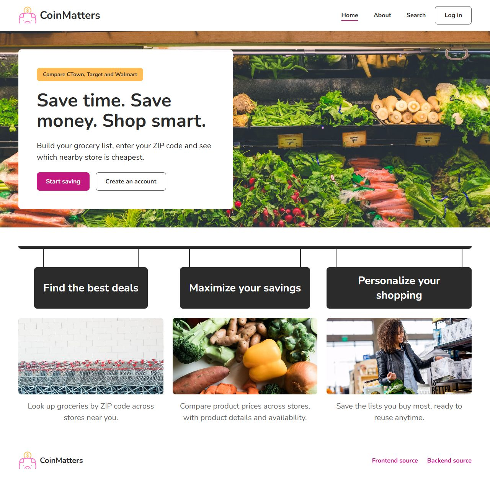
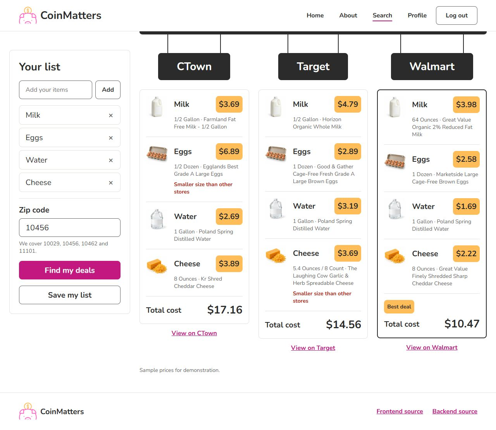
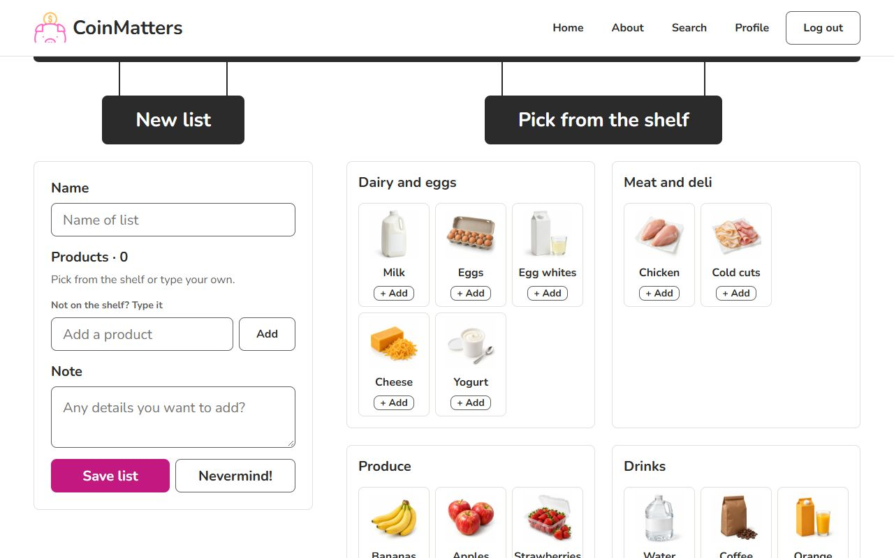
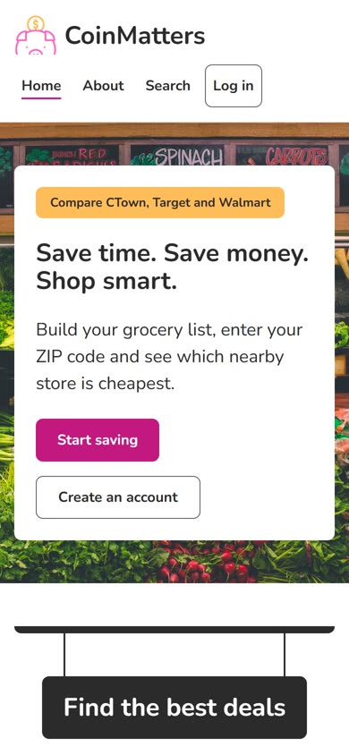
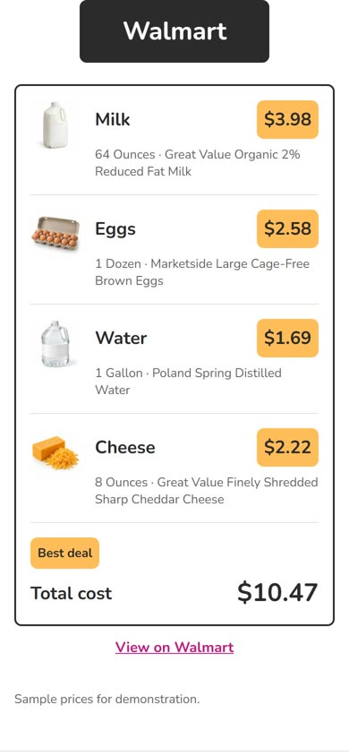

# CoinMatters

Compare what your grocery list costs at nearby stores. Build a list, enter
your ZIP code, and see each store's total with the best deal marked. This is
the React frontend; the data comes from the
[CoinMatters API](https://github.com/antunishdPursuit/Coinmatters-backened).



## Features

- Compare a grocery list at every store that serves your ZIP code
- See each store's cheapest match for every item, with its size and price
- Only a store that has every item can be the best deal; a store missing
  something names what it's missing
- Get a warning when a store sells an item in a smaller size than the others
- Register and log in to save lists
- Build a list from a shelf of what the stores stock, or type your own items
- Compare, edit or delete saved lists from My lists
- Use it on desktop or phone

| Search results | New list |
|---|---|
|  |  |

| On a phone | |
|---|---|
|  |  |

## Try it with the sample account

The API's sample data includes `testuser@example.com` with the password
`password123`. That account already has two saved lists, a *Grocery List*
(milk, eggs, water, cheese) and a *Party List* (pizza, ice cream, water,
yogurt), so the whole flow can be tried without typing anything:

1. Log in and open **My lists**.
2. Choose **Compare prices** on the Grocery List.
3. Enter ZIP code `10456` and choose **Find my deals**.
4. Go back to My lists and **Edit** or **Delete** a list, or start a **New list**.

## Built With

- React 19 and React Router 7
- Vite for local development and production builds
- axios for API calls
- Vitest and Testing Library for tests

## Run Locally

Requirements:

- Node.js 22.12 or newer (tested on Node 24)
- The CoinMatters API running locally (see its README)

```bash
npm ci
```

Create `.env.local` with the API's address:

```bash
VITE_API_URL=http://127.0.0.1:3013
```

```bash
npm start
```

Open `http://127.0.0.1:3220`. The API only accepts requests from this
address, so keep the port as is.

## Testing

```bash
npm test
npm run build
```

`npm test` runs the tests in a simulated browser with the API mocked, so the
API doesn't need to be running. `npm run build` creates the production build
in `dist/`.

## Technical Notes

- The price comparison runs in the browser, using the products and stores
  the API serves.
- Pages for logged-in users wait for the login check, so a reload keeps you
  where you were.
- Item photos live in the repository. An item without a photo, such as one
  typed by hand, shows the CoinMatters logo.
- The theme lives in `src/index.css`. Its tokens come from Dennys's design
  system.

## Limitations

- Prices are sample data, not live store prices.
- Items are matched by name, so "milk" can match a different kind of milk.
- The sample stores cover four New York City ZIP codes: 10029, 10456, 10462
  and 11101.
- The app runs locally only; there is no public deployment.

## Credits

CoinMatters began in 2023 as a team capstone project built by **Irwin
Jorge**, **Noni Porter** and **Dennys Antunish**, with **Lakisha Johnson**,
who shaped the initial layout and contributed code. Tech mentor **Will
Dickerson** helped design the data model, and design mentor **Dillon
Eversman** guided the page layout.

In 2026 Dennys rebuilt it with Claude Code, an AI coding assistant: the move
to Vite, updated dependencies, bug fixes, a new design for every page, and
tests.
